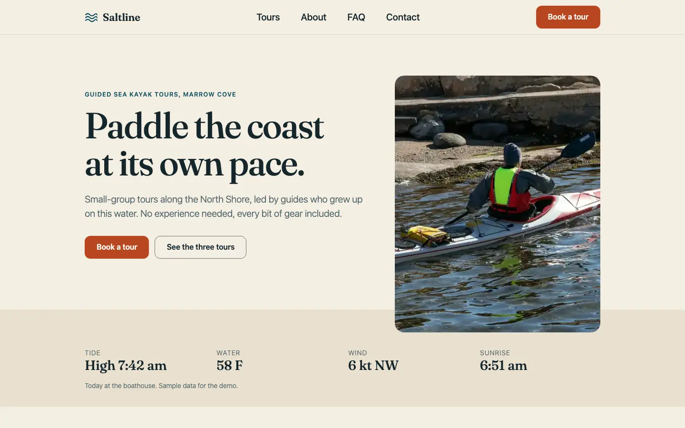
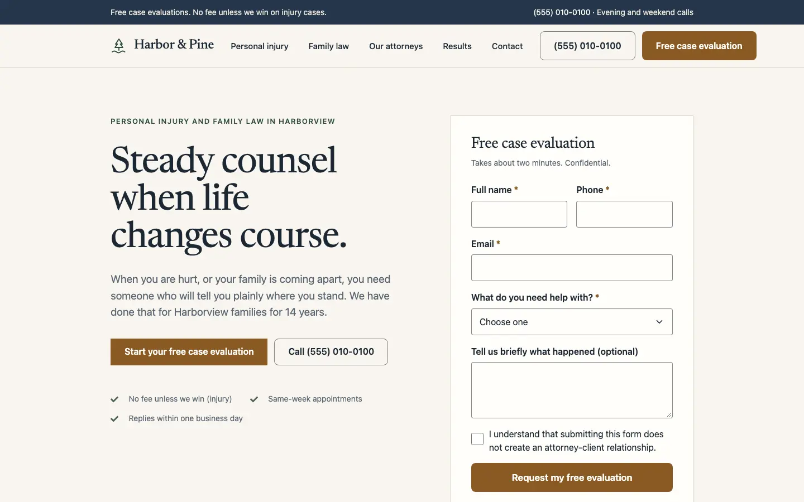
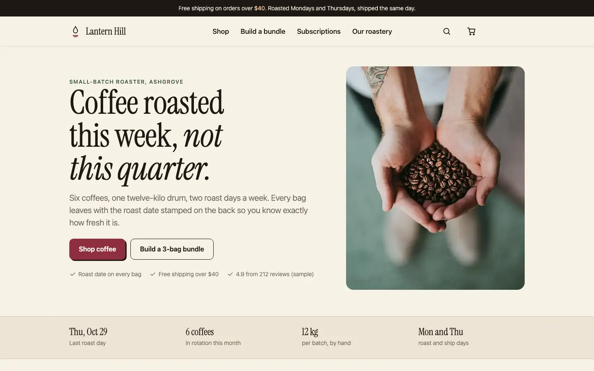
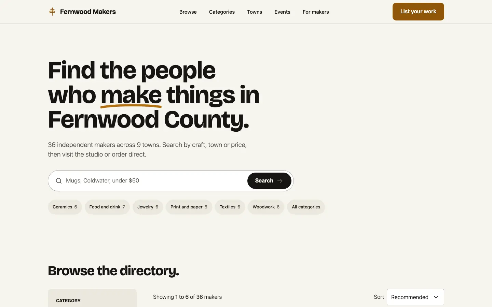
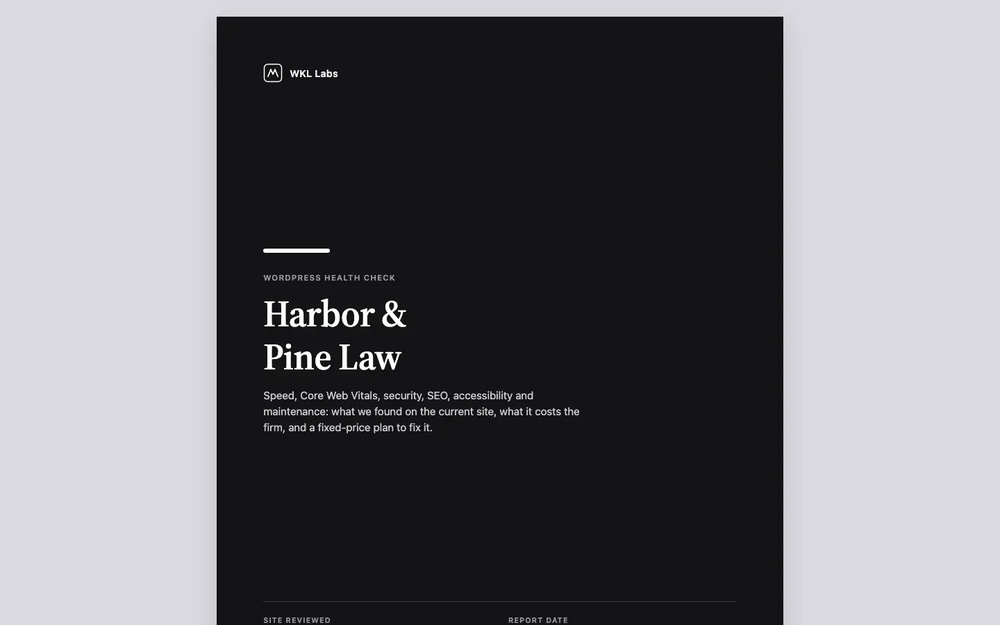

# WordPress portfolio demos

**Live:** [**williamwkl.github.io/wkl-wp-demos**](https://williamwkl.github.io/wkl-wp-demos/)

| [Saltline Kayak Tours](https://williamwkl.github.io/wkl-wp-demos/saltline/) | [Harbor & Pine Law](https://williamwkl.github.io/wkl-wp-demos/harbor-pine/) |
|---|---|
| [](https://williamwkl.github.io/wkl-wp-demos/saltline/) | [](https://williamwkl.github.io/wkl-wp-demos/harbor-pine/) |
| Block theme tour company with online booking | Elementor law firm with a documented speed fix |
| [**Lantern Hill Roasters**](https://williamwkl.github.io/wkl-wp-demos/store/) | [**Fernwood Makers**](https://williamwkl.github.io/wkl-wp-demos/makers/) |
| [](https://williamwkl.github.io/wkl-wp-demos/store/) | [](https://williamwkl.github.io/wkl-wp-demos/makers/) |
| WooCommerce store with a bundle builder | Searchable directory with Google Sheets import |
| [**WordPress health check (sample report)**](https://williamwkl.github.io/wkl-wp-demos/health-check/) | |
| [](https://williamwkl.github.io/wkl-wp-demos/health-check/) | |
| Speed, security, SEO and accessibility audit with a fixed-price plan | |


Four WordPress demo sites for fictional businesses, each rebuilt from a WordPress Playground blueprint (WordPress 7.1.4 and every plugin/theme pinned to a tested version from versioned wordpress.org zips; the boot still needs network access to download them) and exported to a static copy for free hosting (GitHub Pages project site `https://williamwkl.github.io/wkl-wp-demos/<demo>/`).

| Demo | What it shows | Stack |
|---|---|---|
| **Saltline Kayak Tours** (`demos/saltline`) | Local service business: hero, tours, testimonials, FAQ accordion, LocalBusiness + TouristTrip schema, and online booking at `/book/`: a six-step flow (tour, date, departure, party, details, confirm) over real Events Manager availability (8 seats per departure, one adult per kid, pay at the boathouse), with a confirmation email preview | Twenty Twenty-Five child block theme, `theme.json` tokens, Yoast SEO, Contact Form 7 (questions), Events Manager 7.4.12 (free) |
| **Harbor & Pine Law** (`demos/harbor-pine`) | Law firm with the intake form as the hero, mobile sticky call bar, documented naive vs optimized performance pass | Hello Elementor child, Elementor (free) containers/widgets, Fluent Forms (free), Yoast SEO |
| **Lantern Hill Roasters** (`demos/store`) | WooCommerce store: variable products (size, grind), category filters, a build-your-own 3-item bundle with a 12 percent discount, real cart and checkout in Playground with an offline "Test order" gateway (no keys), and a static copy with a simulated cart and demo checkout that never sends data | Twenty Twenty-Five child, WooCommerce 11.2.1, Yoast SEO, custom mu-plugin storefront |
| **Fernwood Makers** (`demos/makers`) | Searchable directory: `maker` CPT, craft/town taxonomies, listing meta, search + filters + sort + pagination that work on a static host, Google Sheets CSV import | Twenty Twenty-Five child block theme, custom mu-plugin (no fields/filter plugin), Yoast SEO |

Designs: `design/<demo>/DESIGN.md` and `design/home-mockups/` (design specs, implemented as written; deviations listed below).
Every demo also has `HANDOFF-TEMPLATE.md` (sample client deliverable) and `CREDITS.md` (photo/font licenses). Demo 2 has `OPTIMIZATION.md`; demo 3 has `IMPORT.md`.

## Lighthouse (mobile preset, static export served locally with gzip)

Lighthouse 12, default mobile throttling. Full HTML/JSON reports in `reports/`. The table below is generated from those JSON files by `node scripts/readme-scores.mjs`; `--check` fails if it is stale, if the intro's demo count is wrong, or if any indexable page of a shipped build misses the targets.

<!-- scores:start (generated by scripts/readme-scores.mjs from reports/; do not edit by hand) -->
| Build | Indexable pages | Perf | A11y | Best Pr. | SEO | LCP | CLS |
|---|---|---|---|---|---|---|---|
| Saltline Kayak Tours | 6 | 98 to 100 | 100 | 100 | 100 | 1.7 to 2.3 s | 0 to 0.028 |
| Harbor & Pine Law (optimized) | 7 | 99 to 100 | 100 | 100 | 100 | 1.7 to 2.2 s | 0 |
| Harbor & Pine Law (naive, the "before") | 7 | 81 to 97 | 100 | 100 | 100 | 2.1 to 4.8 s | 0.001 to 0.037 |
| Lantern Hill Roasters | 5 | 99 to 100 | 100 | 100 | 100 | 1.4 to 2.3 s | 0 |
| Fernwood Makers | 10 | 99 to 100 | 100 | 100 | 100 | 1.4 to 2.1 s | 0 to 0.001 |

Not crawlable by design (`noindex, follow`, left out of `sitemap.xml`): Lantern Hill Roasters: demo-cart (SEO 63); Lantern Hill Roasters: demo-checkout (SEO 63); Fernwood Makers: credits (SEO 60).
<!-- scores:end -->

Targets (Perf >= 90, A11y/BP/SEO >= 95, LCP <= 2.5 s, CLS <= 0.1) are met on every indexable page of the four shipped builds. The naive Harbor & Pine build is the "before" and misses Performance/LCP on its photo pages.

Responsive QA (`scripts/check.mjs`, tightened after QA round 1): every page at 360, 390, 768, 1024, 1280 and 1440 px. It fails on any horizontal scroll; body, footer and form text under 16px on phones (only meta text the specs define as small is exempt: eyebrows, card meta, disclaimers); any control smaller than 44 x 44 px, including nav and footer links, filter labels and checkbox labels (only inline links inside running prose are exempt, per WCAG 2.5.8); and images rendered at a distorted aspect ratio. All shipped pages pass. Screenshots at 390, 768 and 1440 for every page are in `screens/<demo>/`.

Form fields: `scripts/field-audit.mjs <origin> <demo>` checks every input, select, textarea and checkbox at 360, 390 and 1440 in WebKit (iPhone emulation) and Chromium, resting and focused: 16px+ text, 48px fields, native iOS chrome removed (custom select arrow), one visible focus ring per demo (not inside wrappers, not clipped), no truncated placeholders or select text, 44px checkbox hit areas. 0 issues on the three demos it was run on (Saltline, Harbor & Pine, Makers); before/after sheets in `screens/<demo>/fields-focus-390.png` (built with `scripts/field-sheet.mjs`).

Other checks: `scripts/linkcheck.mjs dist/<demo>` (0 broken internal references in all four exports), `scripts/copy-lint.mjs` (no em dashes, no "AI", no localhost URLs), and smoke tests on the static exports: `scripts/smoke-saltline.mjs`, `scripts/smoke-harbor-pine.mjs`, `scripts/smoke-makers.mjs` (menus, Escape to close, demo form validation + success state, sticky bar made inert while hidden, directory search/filters/URL sync/pagination/taxonomy pre-check, the filter sheet as a modal dialog with focus trap and focus return, and the no-JS behaviour below).

### Without JavaScript

- Forms: required fields use native browser validation. On the static copies the exporter strips every field `name` and hidden input (nonce, referer) from demo forms, so a submit only opens the `/demo-form/` notice page with no query string: nothing a visitor types reaches the URL, history or server logs (`scripts/smoke-nojs-forms.mjs` checks all 6 forms). A static host answers POST with 405, which is why the forms use GET.
- Makers directory: every listing is shown and the counter states the true number; the search box and filter rail are hidden, and a note links to the real static category and town pages (which are pre-filtered server-side). Query-string filters such as `?category=ceramics` only work with JavaScript on the static copy; on live WordPress the same query string is also applied server-side.


## Run locally

Requirements: Node 20+ (tested on 24), internet access on first boot (Playground downloads WordPress and plugins). No Docker, no PHP install needed.

```bash
npm install                      # playwright, lighthouse (dev tools only)
scripts/serve.sh saltline 9401   # http://127.0.0.1:9401  (wp-admin: admin / password)
scripts/serve.sh harbor-pine 9402
scripts/serve.sh harbor-pine 9402 demos/harbor-pine/blueprint-naive.json   # the "before" build
scripts/serve.sh makers 9403
```

`serve.sh` boots WordPress Playground CLI with the demo's `blueprint.json` and mounts `theme/`, `mu-plugins/` and `data/` from the repo, so edits to those files show on reload. Each boot is a fresh site (the blueprint seeds it in about 90 seconds).

## Public URL (one config value)

`site.config.json` holds `base` (the github.io project site, the permanent public URL; there is no custom domain and no CNAME) and `rawBase` (raw GitHub files for the Playground links, pinned to a release ref). `scripts/site-base.mjs` reads it; the exporter, redirect stubs, Health Check and `scripts/root-files.mjs` all use it for canonicals, og URLs, JSON-LD and sitemaps. `root-files.mjs` also writes a root `robots.txt` and sitemap index; crawlers only read robots.txt at a host root, so under the `/wkl-wp-demos/` subpath it is ignored (harmless), and the sitemap index is still useful to submit by hand. `scripts/check-base.mjs` fails the build if any page or sitemap strays from `base` or leaks a local origin. All internal links and assets are relative, so the same export works at the domain root (`/saltline/`, `/harbor-pine/`, `/makers/`, `/store/`, `/health-check/`) and under any sub-folder.

## Health Check report

`node scripts/health-data.mjs && node scripts/health-check.mjs` builds `deliverables/WordPress-Health-Check-Sample.pdf` (9 letter pages) and the web copy at `dist/health-check/`. Sources: `health-check/data.json` (Lighthouse figures, extracted from `reports/harbor-pine/*/*.report.json`), `health-check/audit.json` (the security and maintenance checks, plus every non-Lighthouse figure as a named fact with a source; facts with `file`/`match` are checked against that file, e.g. plugin versions against the blueprint) and `health-check/offer.json` (prices). Figures enter the report only through placeholders, rendered by `scripts/health-render.mjs`. Every figure renders its OWN label and page from the field, so a figure cannot be shown under the wrong label or page: `{{metric now.home.cls}}` renders "Home CLS 0.031", `{{metric now.*.requests|range}}` renders "30 to 38 requests per page", `{{pair family-law.lcp_s}}` renders "Family law LCP: 4.8 s before, 2.1 s after", `{{group now scores.accessibility,scores.best-practices,scores.seo}}` renders "Accessibility, Best Practices and SEO score 100 on every page" (and fails if the values differ), `{{page home requests,cls}}` names the page once for several figures, and an `audit.json` fact renders with its own `render` label (e.g. "1200 px wide"). Lighthouse labels come from one fixed map keyed by field path (`METRIC_LABELS`). A bare `{{value ...}}` is accepted only for label-free fields (the review date, offer prices and days, report meta, check counts) and for counts (`|count`, `|word`). Page footers, finding numbers, fix ranks, order-of-work steps and tier numbers are numbered by the renderer, and references to them (`{{fixes images,fonts,assets}}`, `{{tier security}}`, `{{pageref before-and-after-results}}`) must resolve. The build fails closed, before writing anything: an unknown field, page, pipe, label-map entry, fact render, reference or placeholder kind throws, and any digit in the rendered text that did not come from a placeholder fails (there are no typed-number exceptions). Generated blocks (score dashboard, Core Web Vitals table, LCP chart, before/after table, security and maintenance tables) take their labels from the code and every value from a field. `node scripts/test-health-check.mjs` holds the negative tests (bare metric, distant label, wrong page or label next to a metric, group with differing values, pair and page renderers, unknown field/page/map entry/pipe, typed digits including "page 123", "Fixes 123", "Page 2 of 9", "Tier 2"). Numbers spelled as words are only checked where they come from a placeholder (`|word`). The report carries no contact details (name only).

## Rebuild a static export

```bash
scripts/build.sh saltline                           # export + font license + redirect stubs + root files (robots, sitemap index) + base check
# or by hand: node scripts/export.mjs http://127.0.0.1:9401 dist/saltline   (PUBLIC_BASE env overrides the config)
node scripts/static-server.mjs dist 5055            # GitHub Pages-like server with gzip
node scripts/lh.mjs http://127.0.0.1:5055/saltline reports/saltline / /tours/
node scripts/check.mjs http://127.0.0.1:5055/saltline saltline / /tours/
node scripts/copy-lint.mjs dist/saltline            # no em dashes, no "AI", no localhost leaks
node scripts/linkcheck.mjs dist/saltline            # every internal href/src/url() exists
node scripts/redirect-stubs.mjs dist/makers demos/makers/data/redirects.csv   # makers only: stubs for renamed listing slugs
```

`export.mjs` crawls the running site, rewrites every internal URL to a relative path (so it works under any sub-folder), keeps canonical, og:url, og:image and JSON-LD absolute to `PUBLIC_BASE`, fetches Elementor's runtime chunks and assets referenced from inline JSON, drops server-only head links (feeds, REST, oEmbed), turns POST forms into GET forms aimed at `/demo-form/`, skips paginated `/page/N/` duplicates, and writes `sitemap.xml` + `robots.txt` (robots.txt only takes effect at a domain root, not in a project sub-folder).

Forms on the static copies are demo forms: with JavaScript they validate in the browser and show a success state; without it they land on a `/demo-form/` notice page. No third-party form service is used.

## Live WordPress admin links (Playground)

`playground/<demo>.json` are self-contained blueprints (generated by `node scripts/public-blueprints.mjs [rawBase]`) that fetch the theme and mu-plugins from this repo's raw GitHub URLs and log in as admin. They currently point at the placeholder tag `v1.1.0`: at publish time, create the release tag (or use the commit SHA), re-run the script with that ref, and commit, so a public link always loads exactly the reviewed files. Link format:

`https://playground.wordpress.net/?blueprint-url=https://raw.githubusercontent.com/williamwkl/wkl-wp-demos/v1.1.0/playground/makers.json`

Verified locally by serving the repo as a stand-in for raw GitHub: the makers blueprint booted and rendered all 36 listings. The real raw-GitHub URLs cannot be verified until the repo is published. Playground sites reset on every open (nothing is saved).

## Deviations from the design specs

- Saltline: tours are plain pages, not a `tour` CPT (orchestrator decision 3). The About hero uses a shoreline photo (no free boathouse photo found). Hero photo is 560px wide WebP to keep mobile LCP under 2.5 s; the font preload was dropped for the same reason. The contact map placeholder was removed (address text kept). Photo credits live on a /credits/ page linked from the footer.
- Harbor & Pine: Fluent Forms instead of WPForms/Elementor Form (orchestrator decision 1); header and footer are child-theme PHP templates (lighter than the Header Footer & Blocks plugin). The stock desk photo and the contact map placeholder were removed after design review. Icons come from Font Awesome via Elementor's Icon List (rendered as inline SVG in the optimized build) rather than Lucide. "call centre" changed to "call center" (US firm). The FAQ accordions are an HTML widget with `<details>`.
- Fernwood Makers: the sample dataset has 36 makers, so counts are live (36 makers, 9 towns, town counts 2 to 7) instead of the mockup's "214". Every listing has its own photo; listing galleries show three different photos and never repeat one shown in the "More in" row. Filtering is client-side over server-rendered cards plus a generated JSON index (orchestrator decision 2). The listing map tile was removed rather than faked. "Read the interview" links to the maker page (no interview content in the demo). The display font is subset to Latin at a fixed optical size (32 KB) to keep directory LCP under 2.2 s.

## Repo map

```
demos/<demo>/blueprint.json    Playground blueprint (plugins, theme, settings, seed)
demos/<demo>/theme/            child theme (theme.json or style tokens, templates, assets)
demos/<demo>/mu-plugins/       seed content, structured data, head cleanup, directory plugin (makers)
demos/makers/data/             sample CSV for the Google Sheets import path
dist/<demo>/                   static exports (dist/index.html is a landing page)
reports/<demo>/                Lighthouse HTML + JSON
screens/<demo>/                screenshots (390 / 768 / 1440 per page)
playground/                    public Playground blueprints
scripts/                       serve, export, image pipeline, QA, Lighthouse
```
